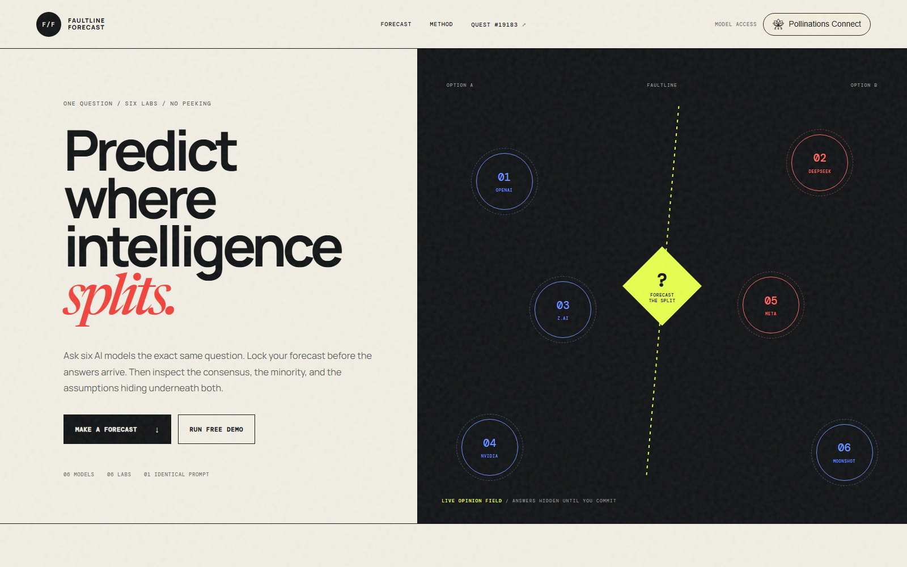

# Faultline Forecast

[](https://pollinations.ai/?ref=badge)

Faultline Forecast is a prediction game for [Pollinations Quest #19183](https://github.com/pollinations/pollinations/issues/19183). Ask six AI models the exact same binary question, forecast how the vote will split, then reveal every answer, confidence score, argument, and hidden assumption.



## How it works

- Six models from six labs receive the same system prompt, question, and two options.
- The player locks a forecast before the live answers are revealed.
- A direct click launches six bounded Pollinations requests using the visitor's temporary BYOP key.
- The app computes the split and forecast score in code; no model judges another model.
- Failed model calls are isolated so one unavailable provider cannot erase the whole poll.
- A scripted zero-Pollen demo is available before wallet connection.

## Development

```bash
npm test
```

The deployable static application is in `dist/`.
